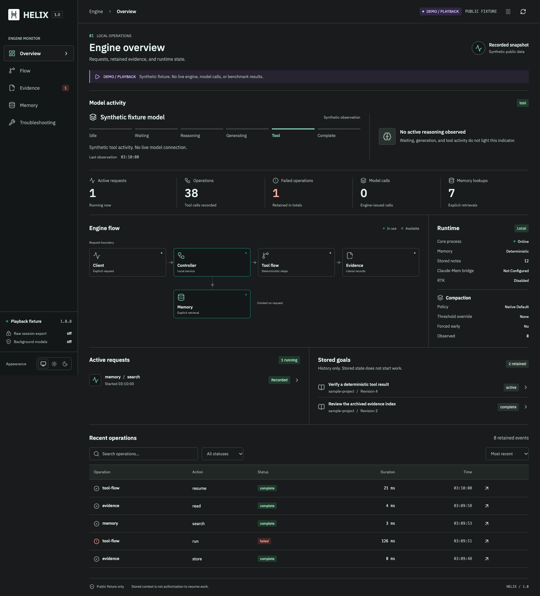

<p align="center">
  
</p>

# HELIX Engine — Antigravity Edition

**Hierarchical Evidence Loading and Intelligent eXecution for Google Antigravity & Gemini Agents.**

<p align="center">
  <a href="https://buymeacoffee.com/superhelix7">
    
  </a>
</p>

[Install](docs/INSTALL.md) · [Architecture](docs/ARCHITECTURE.md) · [Benchmarks](docs/BENCHMARKS.md) · [Modules](docs/MODULES.md) · [Benchmark Ledger](benchmarks/benchmark-results.json)

HELIX is a **local evidence, memory and deterministic execution layer for coding agents**, fine-tuned for Google Antigravity (`agy`) and Gemini 3.8 Flash High.

While the original [HELIX 1.0 for Codex](https://github.com/SuperHelix77/HELIX-1.0) was developed for OpenAI/Codex tooling, this **Antigravity Edition** re-architects context management for Gemini's prompt-caching behavior, introducing **Lean Switch frontier shaping**, **Continuous Context Control**, **Two-Tier context retirement**, and native Antigravity plugin and MCP integration.



*The desktop image uses synthetic data. It is not a screenshot of the measured benchmark.*

## The Result — SWE-bench NEW50 (Gemini 3.8 Flash High)

We conducted an unreset, continuous-context 50-task SWE NEW50 benchmark comparing unmodified Vanilla Gemini 3.8 Flash High against HELIX under strict anti-contamination quarantine and official test suite grading.

Both lanes ran sequential tasks back-to-back within a single native conversation per lane, without synthetic resets or historical patch replay:

| Benchmark Dimension | Vanilla Antigravity | HELIX Antigravity | Empirical Delta | Impact / Multiplier |
| :--- | :---: | :---: | :---: | :---: |
| **Tasks Evaluated** | **50 / 50** | **50 / 50** | 0 (Identical Cohort) | 100% Complete |
| **Official Solves** | **11 / 50 (22.0%)** | **10 / 50 (20.0%)** | -1 Solve (-2.0%) | **90.9% Solve Parity** |
| **Total Billable Tokens** | **452,661,692** | **172,259,815** | **-280,401,877 tokens** | **61.95% Net Savings (2.63x Efficiency)** |
| **Total Cached Context** | **10,503,585,319** | **1,426,600,795** | **-9,076,984,524 tokens** | **86.42% Context Reduction (7.36x Efficiency)** |
| **Input Tokens** | 417,585,602 | 162,218,245 | -255,367,357 tokens | 61.15% Reduction |
| **Output / Gen Tokens** | 35,076,090 | 10,041,570 | -25,034,520 tokens | 71.38% Reduction |
| **Reasoning Tokens** | 24,127,579 | 8,266,825 | -15,860,754 tokens | 65.74% Reduction |
| **Mean Billable / Task** | 9,053,234 tokens | 3,445,196 tokens | -5,608,038 tokens | -5.61M tokens / task |
| **Mean Cache / Task** | 210,071,706 tokens | 28,532,016 tokens | -181,539,690 tokens | -181.5M cached tokens / task |

### Solve Distribution (13 Distinct Solves)
- **Both Solved (8 Tasks):** `django__django-15061`, `django__django-11422`, `django__django-11583`, `django__django-14999`, `django__django-14752`, `django__django-14017`, `django__django-16379`, `sympy__sympy-20212`
- **Vanilla Only (3 Tasks):** `django__django-14534`, `django__django-13448`, `django__django-11564`
- **HELIX Only (2 Tasks):** `django__django-15213`, `django__django-12453`

Every execution event is backed by immutable receipts in [benchmarks/benchmark-results.json](benchmarks/benchmark-results.json).

---

## What Changed in the Antigravity Edition

Compared to the Codex edition of HELIX 1.0:

1. **Lean Switch Frontier Shaping (`lean_run`)**:
   Instead of flooding conversation context with hundreds of lines of pytest or git diff output, Lean Switch generates verified compact status receipts (`[HELIX Lean Switch: run_command exit:0 raw:X bytes; Y passed in Zs; handle:...]`) while preserving error tracebacks. 100% of the raw output is encrypted into local storage, recoverable on demand via `context raw { receipt: handle }`.

2. **Continuous Context Control (`seal`)**:
   In continuous multi-task agent sessions, prior task outputs cause catastrophic prompt cache accumulation ($O(N^2)$). The Antigravity edition introduces the `seal` action (`helix.handoff.v1`), allowing the agent to archive completed task turns into encrypted stores and carry forward only a compact, tamper-evident handoff receipt. This reduced cached context bloat by **86.42%** (from 10.5 billion to 1.43 billion tokens).

3. **Two-Tier Context Optimizer**:
   Combines scoped task retirement with active intra-task aging. Rather than naively truncating history, older tool results transition to compact references while preserving current decision frontiers and exact recovery handles.

4. **Decisive Multi-File Batch Inspection (`batch_inspect`)**:
   Replaces fragmented micro-reads (reading 30 lines across 10 turns) with a single atomic batch range inspection, eliminating intermediate model round-trips.

5. **Native Antigravity Plugin & MCP Server**:
   Ships with native plugin manifests (`~/.gemini/config/plugins/helix/`), tool schemas (`~/.gemini/antigravity/mcp/helix/`), global execution rules, and CLI symlink (`~/.gemini/antigravity/bin/helix`).

## What HELIX actually does

| Module | Job |
| --- | --- |
| **Goal engine** | Tracks the current task, ordered steps, scope, revision, acceptance and cancellation. Old goals never silently become new instructions. |
| **Tool Flow** | Executes bounded, already-authorized mechanical sequences. Ambiguity returns to model judgment instead of being guessed away. |
| **Lean Switch** | Condenses massive command and test outputs into verified compact status receipts while archiving 100% of exact originals for on-demand recovery. |
| **Continuous Context Control** | Encrypts and seals past task scopes upon completion (`helix.handoff.v1`), eliminating context cache bloat across multi-task sessions. |
| **Evidence archive** | Keeps exact tool outputs and generated programs recoverable while returning compact, typed receipts when appropriate. |
| **Context & Two-Tier Aging** | Combines scoped retirement with intra-task aging, index references, and retrieves originals on demand without loss of intelligence. |
| **Memory** | Stores explicit project/task notes in deterministic local SQLite. Search and note round trips do not require an LLM observer. |
| **Claude-Mem bridge** | Optional read-only lookup of an explicitly selected legacy store. It does not silently import private memories or start a background model. |
| **RTK integration** | Filters archived output through RTK where configured, without rerunning original commands. Unavailable or unsafe paths fall back to retained evidence. |
| **Electron monitor** | Shows observed runtime state, flow, evidence, memory and troubleshooting. Reasoning status is shown only when the provider actually exposes that state. |

These components are not all automatically active on every client request. The MCP interface and the opt-in HTTP proxy have different integration boundaries. HELIX does **not** silently patch ChatGPT or Codex, intercept every conversation, or expose private chain-of-thought.

See the [module-by-module guide](docs/MODULES.md) for implementation paths, automatic versus opt-in behavior, and limitations.

## Install and run

Requires **Node.js 22.19+**, npm and Git. Python 3 is optional for AST-aware Python indexing. Local memory, evidence and monitoring do not require an API key.

```sh
git clone https://github.com/SuperHelix77/HELIX-1.0.git
cd HELIX-1.0
npm ci
npm run build
node bin/helix.mjs start
npm run desktop
```

The desktop connects to an owner-private loopback service. Closing the window does not stop the service. Stop it explicitly with:

```sh
node bin/helix.mjs stop
```

The dependency install may download Electron. Platform-native packaging must be tested on its target OS; a source build is not evidence of a signed or notarized distribution. Full instructions: [INSTALL.md](docs/INSTALL.md).

### Connect Codex or another MCP client

```sh
node bin/helix.mjs install
```

This generates `~/.helix/codex-mcp.toml` for review; it does **not** change Codex authentication or settings. After inspection, register the adapter in a compatible Codex CLI:

```sh
codex mcp add helix -- node "$PWD/bin/helix.mjs" mcp
codex mcp list
```

Reload the client's tools. The adapter exposes `goal`, `context` and `memory` over the same local service. Other compatible clients can use the same stdio entrypoint. The optional Responses proxy is documented in [INSTALL.md](docs/INSTALL.md); it is not a global router and does not replace a client's native WebSocket stack.

### Connect Google Antigravity

HELIX integrates natively into Google Antigravity as both a plugin and an MCP server:

```sh
# 1. Symlink CLI to Antigravity binary directory
ln -sf "$PWD/bin/helix.mjs" ~/.gemini/antigravity/bin/helix

# 2. Check engine daemon status
helix status

# 3. Start background engine daemon if stopped
helix start
```

Antigravity automatically discovers HELIX tools (`goal`, `context`, `memory`) via `~/.gemini/antigravity/mcp/helix/` and activates the `/helixcontext` skill from `~/.gemini/config/plugins/helix/`.

## See what the engine is doing

The Electron application is an inspection and troubleshooting surface, not a second autonomous agent. It exposes retained operations, evidence references, explicit memories and observable request states. A reasoning indicator is **not** a window into hidden thoughts. If the native event feed is unavailable, the monitor cannot infer those states.

The default release app deliberately excludes the development benchmark monitor. To inspect a reviewed benchmark run:

```sh
npm run build:monitor
node bin/helix.mjs watch /path/to/a/reviewed/new50-run
npm run desktop:monitor
```

Monitoring never launches a benchmark. It displays known usage and official matched grades without silently treating unknown usage as zero.

## Build, test, inspect

```sh
npm test
npm run check
npm run build
npm run test:ui
npm run test:electron
npm run privacy
```

`npm run package` creates an unpacked app for the current platform. See [security and privacy](SECURITY.md), [architecture](docs/ARCHITECTURE.md), and [installation/recovery](docs/INSTALL.md).

HELIX executes authorized commands with the host account's permissions. **It is not a sandbox.** A declared tool operation is consequential authorization. Keep capability tokens private, review task scopes and do not expose local execution endpoints.

## What comes next

The first release is a foundation, not the end of the research. The immediate problem is clear: recover the four lost solves and investigate why HELIX generated 79 additional primary model requests and more reasoning/output. Context retirement is useful; it is not enough on its own.

Longer-term work on memory, continuous context control, model-independent handoffs and Lean Switch remains research. **95% savings is a target, not a result.** I will not label it achieved until the measurements justify it.

## Acknowledgments, licensing and support

The HELIX double-strand identity comes from [Helix Harness](https://github.com/SuperHelix77/Helix-Harness). This banner adapts that project's header rather than inventing a different brand. The mark retains its separate AGPL-3.0 attribution; see [visual credits](docs/ASSETS.md).

The engine code is MIT-licensed ([LICENSE](LICENSE)); third-party code and artwork retain their applicable licenses ([notices](THIRD_PARTY_NOTICES.md)). The engine core is adapted from the MIT-licensed codex-router working tree, with source hashes in [upstream provenance](docs/upstream-provenance.json). No affiliation or endorsement by OpenAI, Anthropic, RTK, Unsloth or Argon Bridge is implied.

I build HELIX because I want capable models to spend more of their time solving problems and less of it rediscovering their own work. A year of experiments went into this release. Some worked. Many didn't. The failures stay in the record.

If the project is useful, [buy me a coffee](https://buymeacoffee.com/superhelix7). It helps sustain the work.
