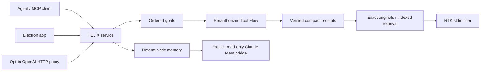

# The Engine, In Pieces

One local service owns this package. MCP adapters, the optional HTTP proxy and Electron connect to it; they do not create competing memory workers or model daemons.

## Goals

`helix-goal-engine.mjs` keeps the current ordered plan, revision, bindings, acceptance review and cancellation state. Mechanical acceptance is not semantic correctness. Stored goals never authorize a new task or continue unrelated work.

## Tool Flow And Process Supervision

`helix-tool-flow.mjs`, admission checks and native operation helpers execute decisions already declared by the agent. Commands are shell-free at the engine boundary, bounded and cancelled with their process trees. Unknown states, new failures and semantic choices return to the model. This is not an infinite autonomous decision loop.

## Evidence And Deltas

`helix-evidence.mjs` builds independently checked partial receipts. `helix-evidence-delta.mjs` compares complete compatible reports by identity rather than guessing that a shorter log means success. Exact edits, source bindings and reusable workflows avoid reconstructing already-decided operations. Every projection keeps a recovery route.

## Original Stores And Context

Tool-result retention, program retention, scoped aging and archive modules preserve originals before historical material is replaced. Indexed ranges recover exact bytes cheaply. The client controls compaction defaults. The production HTTP optimizer and the benchmark native broker are different integration surfaces; installing MCP alone does not rewrite every client request.

## Memory And Claude-Mem

`memory.mjs` stores literal project/task notes in local SQLite, with deterministic search, bounded browsing and exact reading. Rejected hypotheses and settled decisions can be stored without turning memory into a task queue. No LLM extraction, embeddings, Ollama or llama-server is required.

The integrated Claude-Mem adapter opens an explicitly selected existing database read-only. It does not vendor or start the external Claude-Mem observer. This avoids a second background inference service and keeps private memories out of the repository. The local app can browse either source without exporting it.

## RTK

`rtk-adapter.mjs` sends an already archived log to `rtk pipe`, not a command to run again. It requires an available operator-installed binary and confirmed telemetry-off state. A filter is a partial observation, never evidence that a task passed. The raw hash remains authoritative. Unsupported filters, oversized/binary logs and unusable output return a typed native boundary. RTK's removed-byte counts are not provider-token measurements.

## Model Stream And Live App

`openai-proxy.mjs` optionally forwards a caller-authenticated Responses HTTP stream to an explicitly configured official OpenAI base. It never discovers authentication or chooses fallback models. `model-state.mjs` observes event types only: waiting, reasoning, generation, tool preparation and completion/failure. It does not collect private reasoning text. When no model stream is connected, the app says so rather than inferring thinking from elapsed time.

The Electron renderer is isolated from Node and the service capability. A narrow preload offers snapshot, memory, evidence and troubleshooting actions. Restarting the core requires an explicit UI confirmation and is refused during active operations. Benchmark UI is excluded from the release build.

## What This Release Does Not Prove

It does not prove universal quality parity, 85-90% savings, lower output, cheaper subscription usage, instantaneous tools, Windows/Linux binary behavior, or automatic interception of stock ChatGPT conversations. V3 benchmark evidence and the current adapter tests are reported separately. The known post-benchmark finalization failure remains disclosed; it is not relabelled as a successful native exit.
